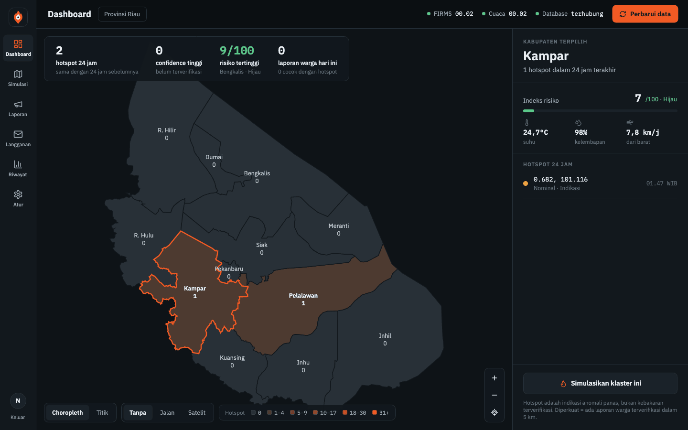
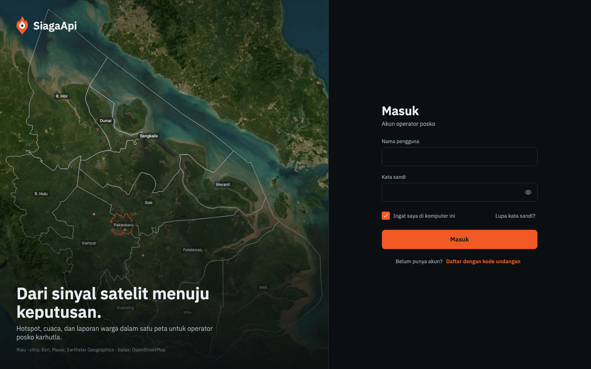
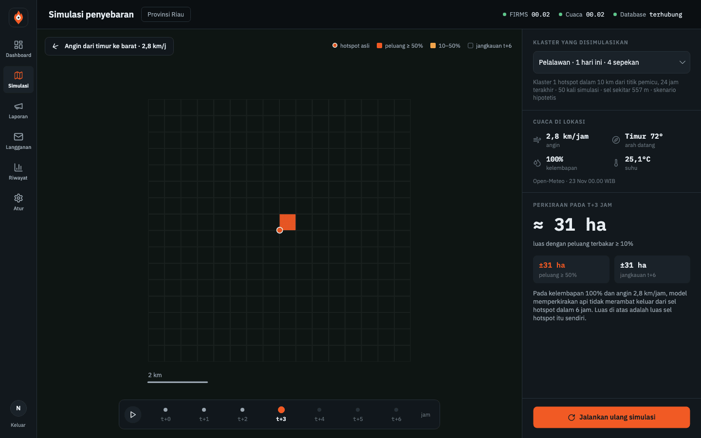
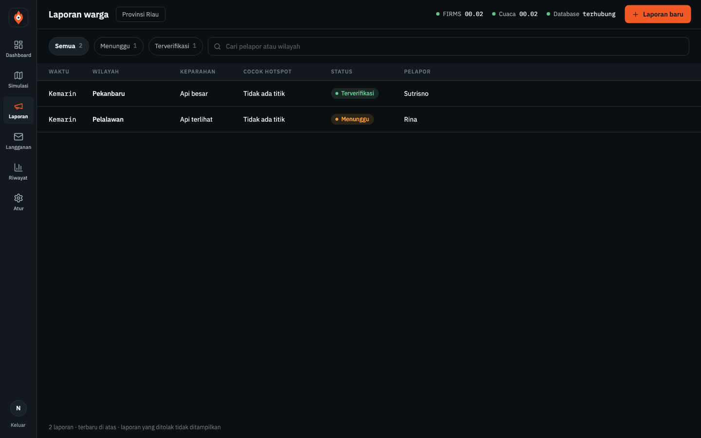
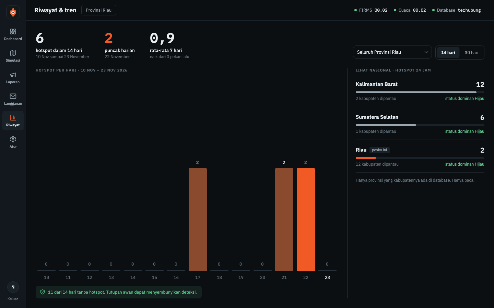
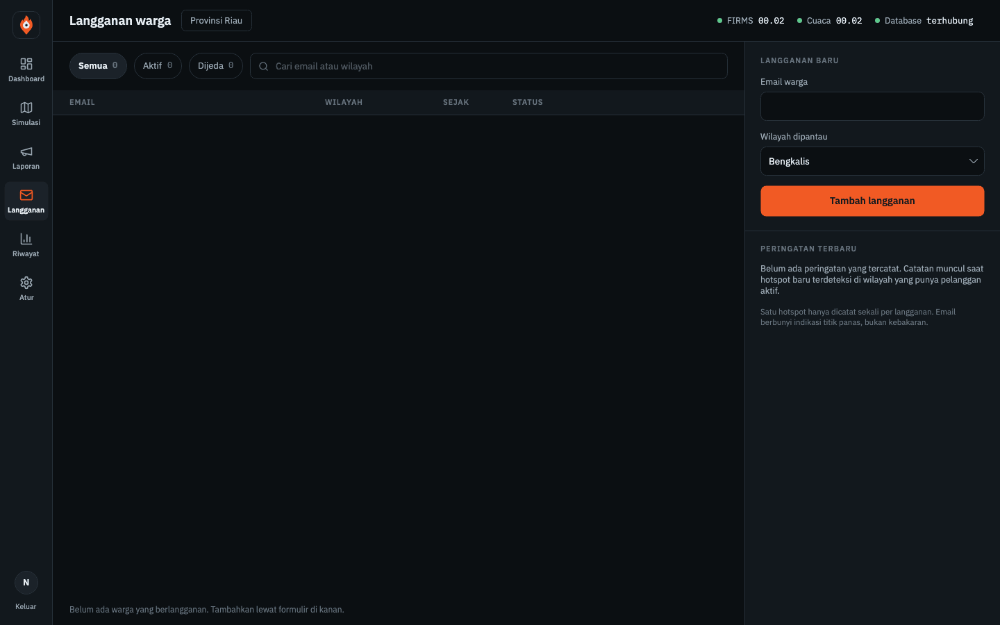
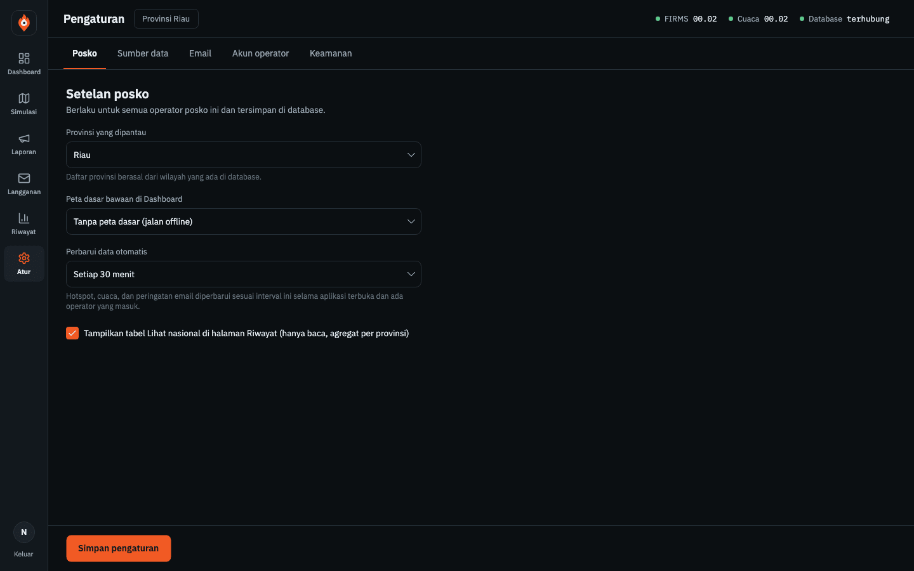

# SiagaApi

Aplikasi desktop untuk operator posko kebakaran hutan dan lahan (karhutla). SiagaApi mengumpulkan titik panas satelit, cuaca, dan laporan warga ke dalam satu peta, lalu membantu operator menilai risiko dan memperkirakan arah penyebaran api.

Dibuat dengan C# (.NET 10), Avalonia, dan PostgreSQL untuk mata kuliah Junior Project.

**Kelompok NinuNinu**

| Peran | Nama | NIM |
| --- | --- | --- |
| Ketua | Muhammad Nabil Fitriansyah Boernama | 24/545232/TK/60628 |
| Anggota | Yuki Shafa Maheswari | 24/545600/TK/60708 |
| Anggota | Axel Urwawuska Atarubby | 24/545465/TK/60670 |



## Apa yang bisa dilakukan

- **Dashboard:** peta kabupaten per provinsi dengan jumlah hotspot 24 jam, indeks risiko, cuaca, dan daftar hotspot tiap kabupaten. Peta bisa digeser dan diperbesar, dengan pilihan peta dasar jalan atau citra satelit.
- **Simulasi penyebaran:** perkiraan arah dan luas rambatan api 6 jam ke depan dari hotspot dan cuaca nyata (50 kali simulasi Monte Carlo).
- **Laporan warga:** operator mencatat laporan dari warga. Laporan otomatis dicocokkan dengan hotspot dalam radius 5 km.
- **Langganan warga:** warga mendaftarkan email untuk menerima peringatan saat ada hotspot baru di wilayahnya.
- **Riwayat dan tren:** grafik hotspot harian 14 atau 30 hari, ditambah ringkasan per provinsi.
- **Akun dan peran:** Super Admin, Admin, dan Operator, dengan pendaftaran lewat kode undangan dan persetujuan admin.

Hotspot di aplikasi ini adalah indikasi anomali panas dari satelit, bukan kebakaran yang sudah dipastikan.

## Tampilan

| Masuk | Simulasi penyebaran |
| --- | --- |
|  |  |

| Laporan warga | Riwayat dan tren |
| --- | --- |
|  |  |

| Langganan warga | Pengaturan |
| --- | --- |
|  |  |

Tangkapan layar lain ada di `Docs/desain/baru/`. Tampilan lama dan rancangan ada di `Docs/desain/images/` dan `Docs/desain/usulan/`. Berkas desainnya `Docs/desain/siagaapi-ui.pen`, dibuka dengan aplikasi pen.dev.

## Cara menjalankan

### Dari paket zip (paling mudah, Windows)

1. Minta `SiagaApi-win-x64.zip` ke anggota tim. Zip tidak ditaruh di repo ini karena berisi kata sandi database.
2. Ekstrak zip ke folder mana saja.
3. Jalankan `SiagaApi.exe`. Tidak perlu memasang .NET atau PostgreSQL.
4. Masuk dengan akun yang sudah ada, atau daftar dengan kode undangan (lihat bagian Akun).

Yang dibutuhkan: Windows 10/11 64-bit dan koneksi internet. Ukuran zip sekitar 45 MB, `SiagaApi.exe` sekitar 107 MB setelah diekstrak. Karena `.exe` belum ditandatangani, Windows mungkin menampilkan peringatan SmartScreen saat pertama dijalankan.

Isi zip:

| Berkas | Guna |
| --- | --- |
| `SiagaApi.exe` | Aplikasinya |
| `appsettings.json` | Alamat dan kata sandi database. Jangan dibagikan ke luar tim |
| `Database/*.sql` | Skema, batas wilayah, dan akun awal, kalau mau memasang database sendiri |

### Dari source

```bash
git clone https://github.com/nabil-boernama/SiagaApi.git
cd SiagaApi
# salin appsettings.example.json menjadi appsettings.json, lalu isi connection string
dotnet run
```

Butuh .NET SDK 10. Tanpa `appsettings.json`, aplikasi mencari PostgreSQL di `localhost` dengan pengguna `postgres`.

## Database (Neon)

Database memakai PostgreSQL di [Neon](https://neon.tech), jadi semua anggota tim dan penguji memakai data yang sama tanpa memasang PostgreSQL di komputer masing-masing.

Aplikasi membaca connection string dengan urutan berikut:

1. Environment variable `SIAGAAPI_DB`.
2. `appsettings.json` di samping `SiagaApi.exe`, kunci `ConnectionStrings:SiagaApi`.
3. Bawaan `localhost`.

Formatnya gaya Npgsql, bukan URL `postgresql://`:

```json
{
  "ConnectionStrings": {
    "SiagaApi": "Host=<host>;Port=5432;Username=<user>;Password=<password>;Database=siagaapi;SSL Mode=Require"
  }
}
```

Aplikasi masuk ke database dengan peran terbatas yang tidak bisa menghapus tabel atau mengubah skema. Peran pemilik hanya dipakai saat memasang skema.

### Memasang database sendiri

Kalau ingin memakai PostgreSQL sendiri (lokal atau project Neon lain), jalankan berurutan:

```bash
psql -d siagaapi -f Database/siagaapi.sql        # tabel dan data wilayah
psql -d siagaapi -f Database/batas_wilayah.sql   # batas kabupaten untuk peta
psql -d siagaapi -f Database/akun_awal.sql       # akun super admin pertama
```

`Database/akun_awal.sql` tidak ada di repo. Buat dari `Database/akun_awal.example.sql`, atau pakai yang ada di dalam zip.

## Akun dan kode undangan

| Peran | Yang bisa dilakukan |
| --- | --- |
| Super Admin | Semua hal, termasuk mengubah peran akun lain |
| Admin | Menyetujui pendaftar, mengelola Operator, membuat kode undangan, mengubah setelan posko |
| Operator | Memakai semua halaman, tanpa mengelola akun atau setelan posko |

Cara membuat akun baru:

1. Admin membuka **Pengaturan > Akun operator** dan menyalin kode undangan posko.
2. Calon operator membuka halaman **Daftar**, mengisi data, dan memasukkan kode itu.
3. Akun baru berstatus Menunggu. Admin menekan **Setujui** di tab yang sama, baru akun itu bisa masuk.

Satu kode undangan bisa dipakai banyak orang dan berlaku sampai admin menekan **Buat kode baru**. Kode dan kata sandi akun tidak ditulis di repo ini; mintalah ke admin posko.

Lupa kata sandi: minta admin menekan **Reset sandi**, lalu masuk dengan kata sandi sementara dan ganti di **Pengaturan > Keamanan**. Lima kali salah kata sandi mengunci akun selama 5 menit.

## Layanan web yang dipakai

| Layanan | Untuk apa | Kunci API |
| --- | --- | --- |
| NASA FIRMS | Titik panas satelit (VIIRS dan MODIS) | Tidak wajib |
| Open-Meteo | Suhu, kelembapan, arah dan kecepatan angin | Tidak perlu |
| OpenStreetMap dan Esri | Ubin peta jalan dan citra satelit | Tidak perlu |
| SMTP | Email peringatan ke pelanggan | Diisi di Pengaturan > Email |

Data diambil saat operator menekan **Perbarui data** dan otomatis sesuai interval di Pengaturan selama aplikasi terbuka. Hasilnya disimpan ke database, jadi kalau layanan sedang tidak bisa dihubungi, aplikasi tetap menampilkan data terakhir.

## Keamanan

- Kata sandi akun disimpan sebagai hash PBKDF2-SHA256, bukan teks asli.
- `appsettings.json` dan `Database/akun_awal.sql` masuk `.gitignore` karena repo ini publik.
- Kunci API dan kata sandi SMTP hanya disimpan di komputer masing-masing, tidak di database.

## Struktur repo

```
Backend/Models      kelas domain (Wilayah, TitikPanas, LaporanWarga, ...)
Backend/Data        koneksi dan repository PostgreSQL
Backend/Services    autentikasi, sinkronisasi data, simulasi, notifikasi
ViewModels, Views   tampilan Avalonia (MVVM)
Database            skema SQL
Docs                dokumentasi tim dan desain
```

## Dokumentasi

- [Pengujian Black Box (Modul 10)](Docs/M10_Axel_PengujianBlackBox.md)
- [Koneksi PostgreSQL dan skema](Docs/M2_Axel_KoneksiPostgreSQL.md)
- [Panduan kontribusi Git](Docs/Panduan_KontribusiGit.md)
- [Panduan dokumentasi tim](Docs/Panduan_DokumentasiTim.md)
